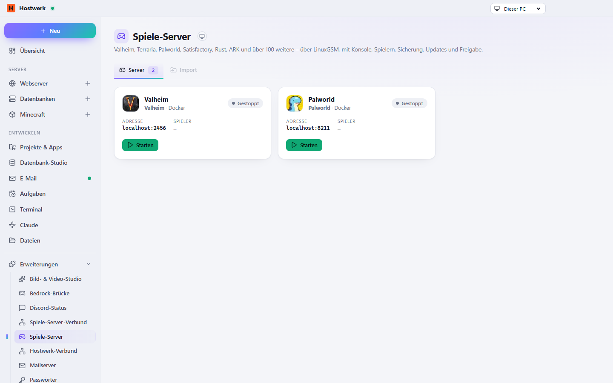

# Spiele-Server

Valheim, Palworld, Satisfactory, Rust, ARK und jedes andere Steam-Server-Tool über SteamCMD – dazu über 100 Spiele über LinuxGSM. Direkt auf dem Rechner, wo es geht, sonst in Docker-Containern.

[English](README.md) · Offizielle [Hostwerk](https://github.com/Passimoritz/hostwerk-public)-Erweiterung (SDK 2.7, native Erweiterung)



## Was sie kann

- **Einrichtung in einem Schritt:** Spiel wählen → Docker (nur wenn nötig, wird mit eingerichtet) → installieren → starten, als eine Aufgabe mit nummerierten Schritten
- **Zwei Wege:** Steam-Server-Tools über SteamCMD (direkt unter Windows und Linux, reine Linux-Tools in Docker) und alle Spiele aus der LinuxGSM-Liste
- Die Steam-Liste bleibt klein: fertige Startzeilen für beliebte Spiele sind eingebaut; die komplette Liste der Steam-Server-Tools nur auf Wunsch, einmal als Datenstrom gelesen, gefiltert, gepackt, 7 Tage genutzt, seitenweise durchsucht
- Konsole, Befehle senden, Spielerliste, Karte und Version per Steam-Abfrage (A2S)
- Alle LinuxGSM-Befehle – auch die spielspezifischen, die das Skript anbietet (z. B. wipe bei Rust)
- Updates (automatisch, wenn niemand spielt), Backups, Überwachen mit Neustart nach Absturz
- Ports und Adressen, Freigabe über die Erweiterung „Router & Portfreigaben“
- Mit Hostwerk starten, Einstellungs-Editor (lgsm-Konfiguration) und Dateibrowser
- Einstellungen je Server: Name, Ports, Spielerzahl, Passwort, Startzeile, Konfigurationsdateien, Update beim Start, Neustart nach Absturz, CPU-/RAM-Grenzen für Container, geplante Neustarts/Backups (über Hostwerks Aufgaben)
- Konsolen-Eingabe für Steam-Server über RCON (CS2, Garry’s Mod, TF2, Rust, ARK …)

## Installieren

In Hostwerk unter **Erweiterungen → Entdecken** auf „Installieren“ klicken. Wer die Funktion schon in Hostwerk 2.8 benutzt hat, bekommt die Erweiterung beim Update automatisch – mit allen Daten.

Native Erweiterungen laufen als Teil von Hostwerk (eigener Server- und Oberflächen-Teil). Darum installiert Hostwerk sie nur aus dem offiziellen Katalog (mit Prüfsumme) oder im Entwickler-Modus.

## Daten

`settings.games, <Hostwerk>/spiele/<server>, Docker volumes hw-game-<server>`, SteamCMD und die zwischengespeicherte Steam-Liste in `<Hostwerk>/data/game-servers` – genau dort, wo Hostwerk sie schon immer abgelegt hat. Entfernen der Erweiterung löscht nichts.

## Entwickeln

```bash
node --test tests/*.test.js          # Tests
node build-native.js .               # Oberfläche bauen (sdk/build-native.js aus hostwerk-public)
node check.js . --strict             # Prüfung wie im Katalog (sdk/check.js)
```

Quelltext der Oberfläche in `ui/src`, Server-Teil in `server/`. Texte im Code sind Englisch, Deutsch steht in `locales/de.json`.

## Lizenz

MIT
