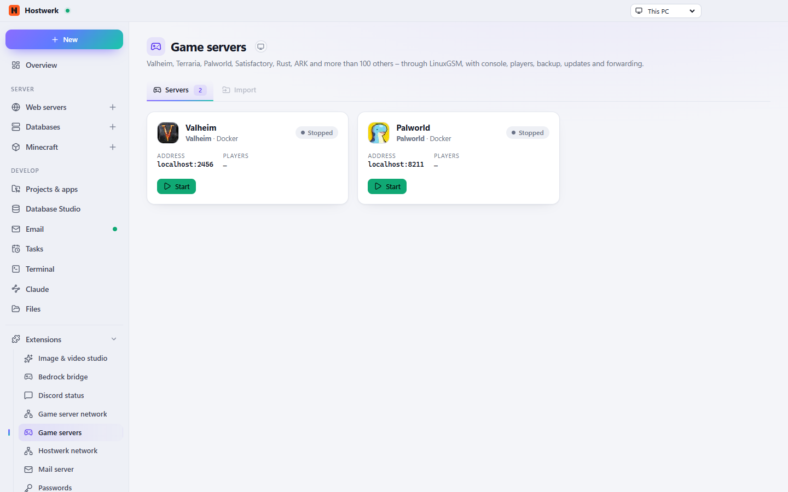

# Game servers

Valheim, Palworld, Rust, Terraria, Satisfactory and more than 100 other games through LinuxGSM – natively on Linux, as Docker containers on Windows.

[Deutsch](README.de.md) · An official [Hostwerk](https://github.com/Passimoritz/hostwerk-public) extension (SDK 2.7, native extension)



## What it does

- Every game from LinuxGSM’s list, picked with logos
- Console, send commands, player list, map and version through the Steam query (A2S)
- Every LinuxGSM command – including the game-specific ones the script offers (e.g. wipe for Rust)
- Updates (automatic when nobody plays), backups, monitor with restart after a crash
- Ports and addresses, forwarding through the “Router & port forwarding” extension
- Start with Hostwerk, settings editor (lgsm config) and file browser

## Install

In Hostwerk: **Extensions → Discover** and click “Install”. If you already used this feature in Hostwerk 2.8, the update installs the extension by itself – with all your data.

Native extensions run as part of Hostwerk (own server and interface part). That is why Hostwerk only installs them from the official catalogue (with checksum) or in developer mode.

## Data

`settings.games, <Hostwerk>/spiele/<server>, Docker volumes hw-game-<server>` – exactly where Hostwerk always kept it. Removing the extension deletes nothing.

## Develop

```bash
node --test tests/*.test.js          # tests
node build-native.js .               # build the interface (sdk/build-native.js from hostwerk-public)
node check.js . --strict             # same check as the catalogue (sdk/check.js)
```

Interface source in `ui/src`, server part in `server/`. Texts in the code are English, German is in `locales/de.json`.

## License

MIT
